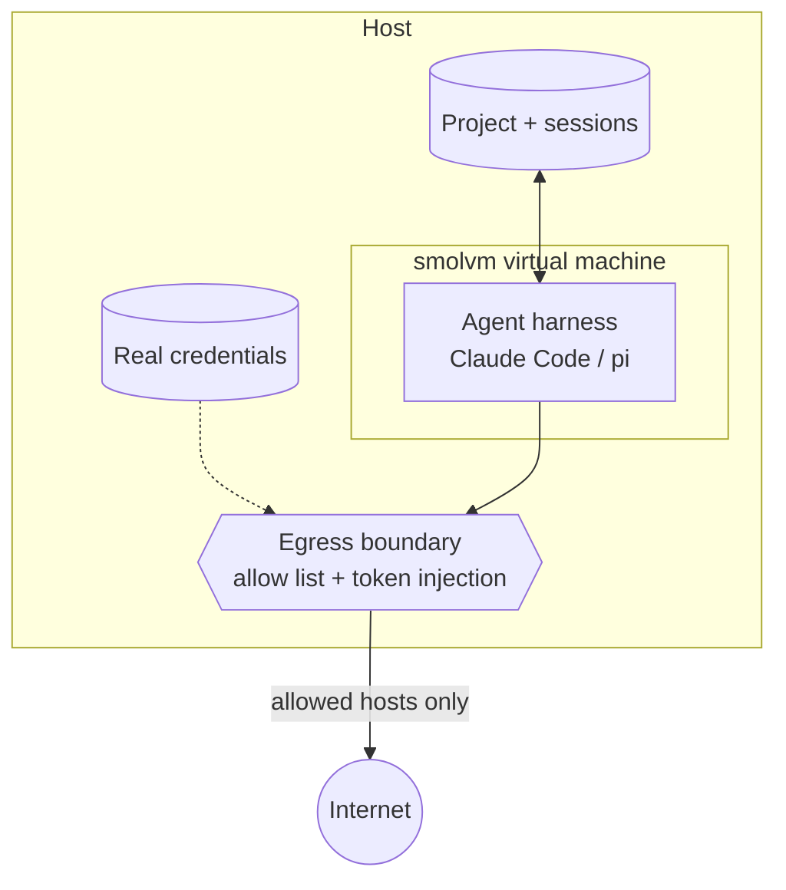

# vankila

*Finnish for "jail".* Run Claude Code and pi with full permissions in a micro-VM, with your project
mounted, egress filtered by an allow list, and API tokens that never enter the VM. See
[SANDBOX.md](SANDBOX.md) for what that does and doesn't stop.

```console
$ vk auth claude     # once: paste a token from `claude setup-token`
$ cd ~/code/thing
$ vk claude          # that's it
```

The first run builds the image, which takes a few minutes. After that a sandbox boots in about a
second.

## Use of AI

The project is built using Claude Opus 5.5. The sandbox was implemented and then audited and reviewed
by the same model. Bulk of the functionality comes from SmolVM, this project is a configuration wrapper and
user interface.

## Sandbox model



Everything the agent does happens inside the VM. Its only way out is through the host-side egress
boundary, which filters by allow list and swaps placeholders for real tokens on the way to the listed
hosts. See [SANDBOX.md](SANDBOX.md) for what this does and doesn't stop.

## Install

Needs Linux with KVM (`/dev/kvm`), and Python 3.11+.

```console
$ uv tool install .
$ vk doctor
$ vk selftest        # proves the isolation on real VMs, using dummy secrets
```

[smolvm](https://smolmachines.com) runs the VMs. If `vk` can't find it, it offers to download a pinned
copy. See [Where smolvm comes from](SANDBOX.md#where-smolvm-comes-from) for the lookup order and what
the pin does and doesn't prove.

## Daily use

| Command | What it does |
|---|---|
| `vk claude [args]`, `vk pi [args]` | Run the harness in this project's sandbox |
| `vk shell` | A shell in the sandbox |
| `vk cargo test`, `vk <anything>` | Run any command in the sandbox |
| `vk status` | State, allow list and credentials |
| `vk blocked` | What the sandbox tried to reach and couldn't |
| `vk allow api.stripe.com` | Allow a host for this project |
| `vk auth [name]` | Show or store credentials |
| `vk trust` | Review and approve a changed `vankila.toml` |
| `vk ls`, `vk stop`, `vk rm [--state]` | Manage sandboxes |
| `vk build --refresh` | Rebuild the image with the latest tools |

Each project (nearest `vankila.toml`, else git root) gets its own VM, mounted at
`/workspace/<name>`. Your working directory carries over. Open as many sessions as you like: the VM
stops when the last one exits, and tells you if anything was blocked along the way.

## What's in the sandbox

- **Tools:** Node, npm, corepack, uv, Rust (with clippy and rustfmt), jq, gh, git, ripgrep, fd,
  build-essential, Claude Code, pi.
- **Egress:** an allow list that stops accidental traffic, but not a determined guest (see
  [Known weaknesses](SANDBOX.md#known-weaknesses)). Private ranges and cloud metadata are always blocked.
- **Registries:** a 14-day cooldown for npm, pnpm, yarn, bun, uv and pip, and install scripts off for
  the npm family. **Cargo has no cooldown** because it doesn't support one yet.
- **Harness config:** Claude Code starts with onboarding done, the folder trusted and permission
  prompts off (the VM is the boundary). Auto-updaters and non-essential traffic are off.
- **Git:** your host identity is passed through, and `git@github.com:` URLs use HTTPS.

## Configuration

No config is required. `vk init` writes a starter file with presets detected from your project.
Settings merge in this order: built-in defaults, `~/.config/vankila/config.toml`, then the project's
`vankila.toml`. A later value replaces an earlier one, including lists, with one exception: hosts in
the global `network.allow` always apply, in addition to the project's. See the
[configuration reference](docs/configuration.md) for every option and where each file lives.

```toml
[network]
presets = ["claude", "github", "npm"]   # anthropic claude github npm pypi crates rust apt
                                        # openai openrouter mistral google-ai
allow = ["api.stripe.com", "*.example.com"]
allow_private = ["10.20.0.0/16"]        # e.g. an internal registry

[sandbox]
cpus = 4
memory = 8192                           # MiB; a cap, only touched memory is used
overlay = 20                            # GiB, persistent root filesystem changes (packages, caches)
storage = 20                            # GiB, image layers and container data
ports = ["3000", "8080:80"]
mounts = ["../shared-lib:/workspace/shared-lib:ro"]
env = { RUST_BACKTRACE = "1" }
setup = ["uv sync"]                     # once per new sandbox, as the agent user, under the allow list
ssh_agent = false                       # forward the host agent (keys stay out, signing is allowed)
keep_running = false                    # leave the VM up after the last session
snapshot = false                        # copy the project before each VM start (last 3 kept)

[tools]                                 # a change builds a new image, shared by matching projects
base = "debian:trixie-slim"
node = "24"
rust = "stable"
apt = ["postgresql-client"]

[registries]
cooldown_days = 14                      # 0 turns it off
ignore_scripts = true

[auth]
claude = "oauth"                        # or "api-key", when both are configured
github = "stored"                       # or "gh", to also use $GH_TOKEN and `gh auth token`

[credentials.stripe]                    # a secret the sandbox can use but never see
env = "STRIPE_API_KEY"                  # the sandbox gets a placeholder in this variable
hosts = ["api.stripe.com"]              # the real value is only ever sent here
command = "pass show stripe"            # optional; or $STRIPE_API_KEY, or `vk auth stripe`
# set_header = "authorization"          # optional; the host sets the whole header instead

[harness.claude]
skip_permissions = true
settings = { model = "opus" }           # merged into ~/.claude/settings.json in the guest

[harness.pi]
settings = { defaultProvider = "anthropic" }  # merged into ~/.pi/agent/settings.json
```

### Harness files

Files laid over the harness config directory on every `vk` start, global first and then project. The
guest copies them itself, and only regular files, so a symlink in there can't reach the host:

```
~/.config/vankila/harness/claude/        CLAUDE.md, skills/, agents/, ...
~/.config/vankila/harness/pi/            AGENTS.md, models.json, ...
<project>/.vankila/harness/{claude,pi}/  the same, for one project
```

Harness sessions live on the host in `~/.local/state/vankila/projects/`, so they outlast the VM.
That makes recreating a sandbox cheap. Anything installed by hand in the VM is lost when it is
recreated, so put it in `setup` or `tools.apt`.

## Credentials

A value is looked up from the host's environment variable, then `vk auth`
(`~/.config/vankila/secrets.toml`, mode 0600), then a command. GitHub is the exception: its token can
reach far beyond one project, so it binds only after `vk auth github`. Set `auth.github = "gh"` to also
use `$GH_TOKEN` and `gh auth token`.

| Name | Guest variable | Sent to | Used by |
|---|---|---|---|
| `claude` | `CLAUDE_CODE_OAUTH_TOKEN` | `api.anthropic.com` | Claude Code |
| `anthropic` | `ANTHROPIC_API_KEY` | `api.anthropic.com` | Claude Code, pi |
| `github` | `GH_TOKEN` | `api.github.com` (and `github.com` for git) | gh, git; opt-in, see above |
| `openai`, `openrouter`, `mistral`, `gemini` | `OPENAI_API_KEY`, etc. | their API host | pi; also add the matching network preset (`gemini` uses `google-ai`) |

Inside the VM, a credential variable holds only a placeholder ([how that works](SANDBOX.md#how-the-guards-work)).
Hosts with a bound credential have some limits, such as refusing a large `git push` over HTTPS: see
[Credential boundary limits](SANDBOX.md#credential-boundary-limits).

**Pi and a Claude subscription:** pi only treats a token as a subscription token when it sees the
`sk-ant-oat` prefix, which a placeholder doesn't have. So boundary injection for pi needs an API key.
Pi's own `/login` still works, but then its token is stored inside the sandbox state.

## Development

```console
$ python3 -m unittest discover -s tests   # host-side logic, against a fake smolvm
$ uv run vk selftest                      # real VMs; needs KVM
```

| Path | Purpose |
|---|---|
| `src/vankila/cli.py` | Commands |
| `src/vankila/config.py` | Config loading, presets |
| `src/vankila/trust.py` | Approval of `vankila.toml` |
| `src/vankila/secrets.py` | Credential lookup and binding |
| `src/vankila/sandbox.py` | Lifecycle, sessions, drift handling |
| `src/vankila/seed.py`, `assets/apply_harness.py` | Registry and harness config; the guest side of it |
| `src/vankila/confine.py` | Landlock confinement of the VM process |
| `src/vankila/image.py`, `assets/provision.sh` | The golden image |
| `src/vankila/selftest.py` | End-to-end checks |
